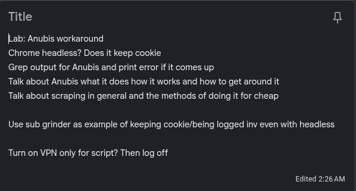

# Anubis Bypass 𓃩

## Background

As part of my work in the writing space, I track and publish information. This includes scraping a couple different websites once a day and comparing today's webpage to historical copies of it. Since the scope of this is so small, I'm just using Python and Linux coreutils. One of the webpages added Anubis recently, which halted my scraper. I can still access the page in my web browser using a VPN, but I'd like to make my script work again. The whole purpose of the script was so that I wouldn't need to manually check and record data.

On a technical level, what my scrapers are doing is requesting the HTML document that is a specified webpage. It then saves this locally (either as a file or a variable in the heap, depending on the script) and uses regular expressions to search for the interesting bits. It opens and reads a file with historical information, compares the old data with the new, does some basic calculations/logic, and then prints the outcome to the terminal. Some data is written to the save file, and then everything is nicely torn down. A webpage is just a file, and a file is something that can be parsed. However, many webpages have "live" elements like JavaScript that can change the content of the page. The pages I'm currently targeting don't change in this way, so the initial fetch of an HTML document works for my purposes.

I'll be using Google Gemini to assist me, as I have access to it as part of my cloud backup subscription. I have neither the personal nor professional resources to meaningfully access more fitting models or to host a model locally. I won't be throwing Gemini at the whole task to do it all for me, but to write small components for me (like if/else statements), giving more information on error statements, and research. I want to know that what I'm making works and how, so that, in case anything breaks, I'll be able to diagnose it and fix it on my own.

## Tasks

For this to work, I need to put together:

1. How to activate/deactivate my VPN via the terminal
2. How to satisfy Anubis while "web browsing" via the terminal
3. How to make my script act differently if it's blocked by Anubis

Note: I use the word "target" in this post to specific the site that I want to scrape. This is *not* Target, as in the 🎯 big box store.

## Tools and Hardware

This will be done on my [main machine](/specs.md) in a mix of the terminal (zsh) and xed (the notepad app). I'll do research and fact checking with the Vivaldi browser and utilizing Google Gemini to speed things up.

## VPN From the Terminal

I already pay for Mullvad VPN and know it let lets me access this website, so I want to use it for this task. As web VPNs change what IP address you're "using" to access servers, we can test if this works by querying a resource that detects what we're sourcing "from":

```bash
└─[$]> curl wttr.in
Weather report: [REDACTED], California, US

      \   /     Sunny
       .-.      +57(59) °F
    ― (   ) ―   ↑ 3 mph
       `-’      9 mi
      /   \     0.0 in
```

I use this as part of my "welcome" script on my computer (along with these scrapers). wttr's documentation states that it automatically pulls the weather based on the location of your IP address, and the city that it shows is correct to my physical location.

Mullvad has an official CLI. I already have the desktop app installed, so I would assume the CLI version would be, too. So let's test that it is (and, if it is, that it works):

```bash
└─[$]> mullvad connect
└─[$]> curl wttr.in
Weather report: Houston, Texas, US

      \   /     Sunny
       .-.      +84(86) °F
    ― (   ) ―   ↖ 8 mph
       `-’      6 mi
      /   \     0.0 in
```

My taskbar also shows that my network is connected to WIREGUARD, which it does so when I use the Mullvad desktop app, so this confirms that it works. I can also request the status in the terminal:

```bash
└─[$]> mullvad status
Connected
    Relay:                  us-hou-wg-002
    Features:               Quantum Resistance
    Visible location:       USA, Houston, TX. IPv4: [REDACTED]
```

I can then run `mullvad disconnect` and re-request wttr.in or `mullvad status` to show that I've disconnected. So, for my daily script, I add:

```bash
# connect to VPN to access resource
mullvad connect
#...
# end VPN/resource access
mullvad disconnect
```

## Satisfy Anubis Challenge

To do so, I first need to understand how Anubis works.

Anubis is a WAF like Cloudflare, but instead of a "human" doing a CAPTCHA (and other signals being read by a central server to determine human-ness), it has the browser do a "proof of work" challenge. It's the same idea as "mining" cryptocurrency, but on a much smaller scale. What's important to know is that it requires the use of JavaScript to do so, which apps like curl aren't using. Once the challenge is finished, your browser is issued a limited-duration cookie so you don't need to recertify every time you access the site. But it shouldn't last forever (or at least for years and years) so that it can't be used for forever.

As I need to access this website in my web browser for other (non-scraping) uses, I'll be getting the cookie legitimately anyways. I just need to figure out how to present it to the server from the terminal. First, I have to export the cookies from my browser, which is Vivaldi, which is based on Chromium. My first attempt was through the terminal:

```bash
yt-dlp --cookies-from-browser vivaldi --cookies vivaldi_cookies.txt --skip-download
```

But I was running into issues with everything not being decrypted. When I looked at the file, it didn't have access to the site I wanted to test. It also isn't a great idea to have all of my cookies, decrypted, lying around on my computer. The sites I'm scraping don't require being logged in or entering any personal information to view them, so the harm of those cookies being stolen is negligible. I went looking for another solution.

Gemini suggested I try a browser extension, especially one that only works locally, so after some research I install [Get cookies.txt LOCALLY](https://chromewebstore.google.com/detail/get-cookiestxt-locally/cclelndahbckbenkjhflpdbgdldlbecc/reviews?hl=en). This allows me to export cookies for one site at a time, which is much more manageable. I want to test this on a website that is *not* using Anubis, but does have different behavior if you have an authenticated session. I decide on [The Submission Grinder](https://thegrinder.diabolicalplots.com), which I use frequently and serve as a volunteer. I know that, when a user is not logged in, the word `logout` is not in the HTML. So I can test if a web session is authenticated by searching for this word.

I also move from vanilla curl to curl-impersonate, which allows me to pass cookies and look less sus in general.

```bash
└─[$]> curl-impersonate-chrome https://thegrinder.diabolicalplots.com -b grinder_cookies.txt  >> out6 ; grep 'Logout' out6
  % Total    % Received % Xferd  Average Speed   Time    Time     Time  Current
                                 Dload  Upload   Total   Spent    Left  Speed
100 97418    0 97418    0     0  44692      0 --:--:--  0:00:02 --:--:-- 44707
                                <li><a href="/Account/Login/Logout">Logout</a></li>
                                <li><a href="/Account/Login/Logout">Logout</a></li>
```

Excellent! We're able to prove we should be logged into a website without human interaction.

But now is for the real test. Can we use this to get past Anubis? I go to my target website and save the cookies. There's only two, which are both Anubis-related.

First, let's see what happens when I access the site without the cookies.

```bash
└─[$]> curl-impersonate-chrome https://target_site/   >> noCookie
```

The `noCookie` output includes various lines about Anubis, including `Anubis could not load its JavaScript`, which is what I'd expect. Now let's try it with the cookie:

```bash
└─[$]> curl-impersonate-chrome https://target_site/ -b target_cookies.txt >> withCookies
```

Looking at the output, it's the page I wanted! We can verify the differences here:

```bash
└─[$]> grep -ic 'anubis' noCookie
7
└─[$]> grep -ic 'anubis' withCookies
0
```

Now I can replace the curl command in my script with the curl-impersonate-chrome line.

```bash
# fetches url and saves to file
curl-impersonate-chrome https://target_site/ -b target_cookies.txt >> "$timestamp".html -s
```

## Vary Behavior if Anubis is Active

Now that we know how to get around Anubis, we need to have a failsafe in case this breaks (such as if the cookie expires). Comparing the Anubis page to the target page shows that the whole page "changed", which breaks a lot of things. So I need my script to exit if it can't get around Anubis, for whatever reason.

To do so, we need to look at the HTML document we curl'd, judge if it's our target page, and then move forward if it is. The previous step has gotten us a copy of each webpage, so we can search the HTML for strings that only the Anubis page would reasonably have. While we could search for just the word 'anubis', there's a non-0 chance that might organically end up on our target page. We want this to work for as many websites as possible, so it should be something more specific, and also something that is unlikely to change over time.

```bash
└─[$]> grep -ic 'This website is running Anubis version' noCookie
1
```

1 is more than 0, which is all that really matters for this. I threw together a simple bash script to test the logic:

```bash
#!/bin/bash

if grep -ic 'This website is running Anubis version' noCookie; then
    echo 'This is running anubis!'
else
    echo 'No anubis here'
fi
```

```bash
└─[$]> ./testScript.sh
1
This is running anubis!
└─[$]> ./testScript.sh #changed file to 'withCookies'
0
No anubis here
```

That's nice, but can we run it without printing the numbers? I add the `-q` flag and ran it again, for both cases:

```bash
└─[$]> ./testScript.sh
No anubis here
└─[$]> ./testScript.sh
This is running anubis!
```

I realize that it's a bit of a pain to hard-code the filename...but this is just for testing! I only need the logic for my production script.

```bash
# checks for Anubis
if grep -icq 'This website is running Anubis version' "$timestamp".html; then
    echo 'Anubis auth cookie failed. Please generate new cookie.'
    exit 1
else
    echo 'Anubis successfully bypassed 𓃩'
fi
```

I ran the script successfully in my testing of this (you can see the code for it [here](https://github.com/ChaseJxyz/website-differ)), and now here's the output:

```bash
└─[$]> BashScripts/website_differ.sh
Anubis successfully bypassed 𓃩
No changes since last check!
```

For completeness, I add one final section before I consider the script closed:

```bash
# Check if curl-impersonate is installed
if ! which curl-impersonate-chrome  &> /dev/null; then
    echo "Error: 'curl-impersonate' is not installed." >&2
    exit 1
fi
```

This is just a tweak of the pandoc checker. I imagine anyone who's copying my code is technical enough to notice an error and sort it out on their own.

## Caveats

This does require the manual exporting of the Anubis auth cookie. Which I believe would only be just once a week, which, for only 1 website, is no big deal. But this is likely something that will annoy me in the near future and I'll figure out a way to automate myself. If this was a much more massive scraper, including sites I've never scraped before, I would need a way to detect Anubis, beat the challenge, and then handle the cookies, all within the app logic. But I also know that the biggest scraping operations hire humans to do these challenges and captchas for them. I'm just one guy with a budget of $0, so this works for now.

It's also possible that the website and/or Anubis will get annoyed with me and block my IP (again). So I'd need to find a way around that. Dig into Mullvad's options and see if there was a way to shuffle my IPs? Route it through something that isn't a VPN company? Forge my HTTP headers to look more organic? There's a lot of possibilities as to what could go wrong, so there's just as many solutions, so I can't predict what I'd do at this point.

They could also switch from Anubis to a totally different WAF, or change how redirects work. My script is only looking if it gets stuck on an *Anubis* page, not that it's not reaching the target page in general. So things can still change and break in a way I can't quite predict on a Sunday afternoon. But I'm sure I'll be able to figure it out!

## Final Thoughts

I came up with the structure of this while trying to fall asleep last night. The exact code, not so much, but the "flowchart" of what it is I'd need to do.



I know why WAFs exist and why they're important. I know the problems mass-scraping causes websites, especially small ones. But I'm very purposeful in what I scrape, and why, and how often.

1. I scrape pages with the most data on them as possible, to minimize the number of pages I need to scrape.
2. I scrape pages only as often that it would be meaningful to do so (once a day)
3. I build my scrapers to access pages less often than my totally-human-counterparts do

3 is a big one for me. For example, I have my [moksha checker](https://github.com/ChaseJxyz/Moksha-Checker), which checks the queue position number of my literary submission. As someone who *also* is a slush reader using moksha, I know that you only meaningfully move up the line either one or three spots per day, or one giant jump in a day (if the editor closes a bunch at once). But I know writers who check this page multiple times a day, sometimes multiple times per *hour*, to see if they've moved yet. But since I only check the page once a day, I'm creating less server overhead with my scraper than a human user might. My automation is lessening my own load on the server.

Nothing I came up with here is earth-shattering. I'm sure the fine folx who maintain Anubis know all about this. But what I'm doing is still small, noise not meaningfully distinguishable from a human user. But I'm glad that my scripts are working again and that I could do this writeup.
